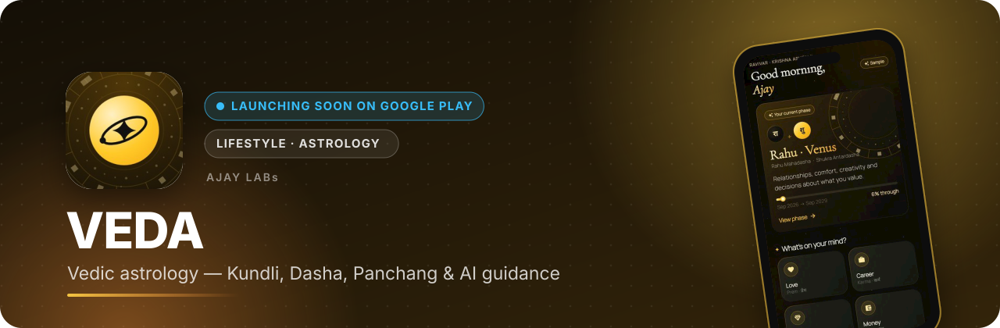
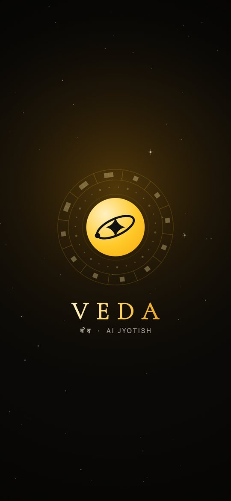
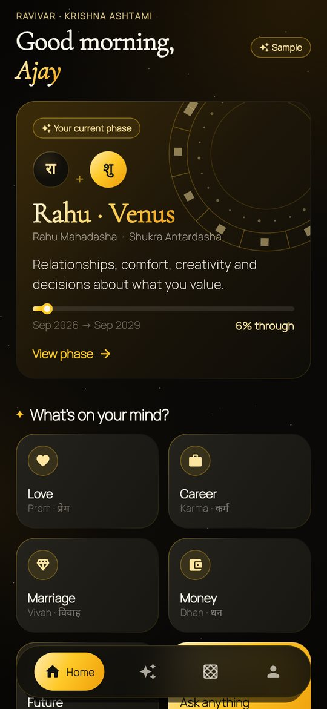
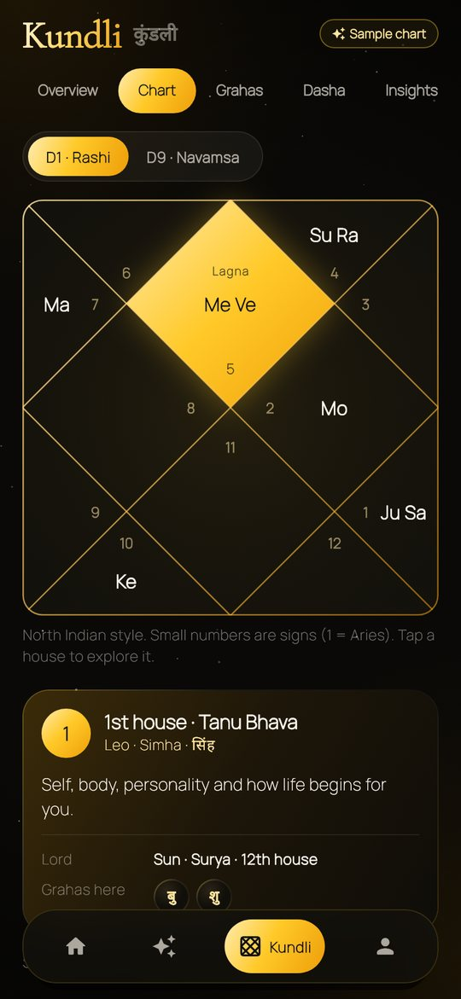
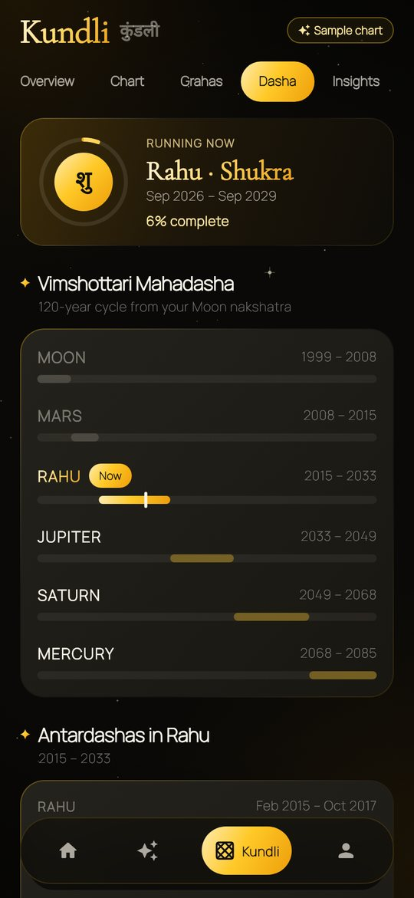
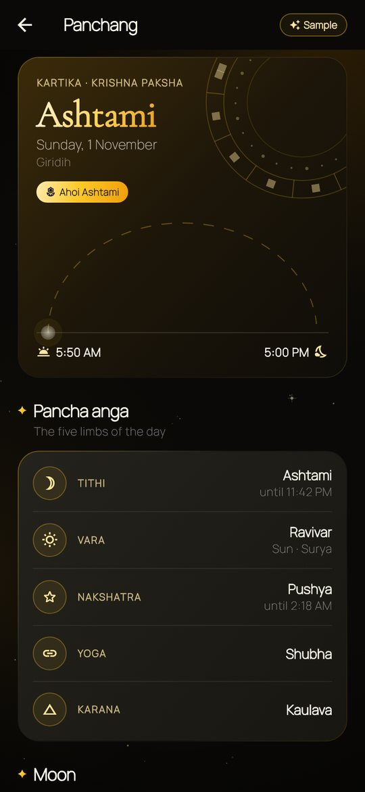
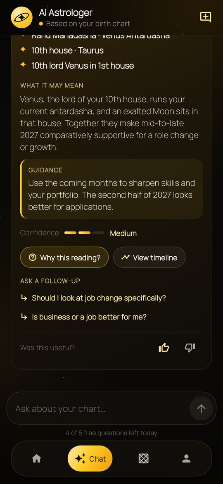

   

---

## ✨ Overview

VEDA is an Android-first Vedic astrology app. It generates a full **Kundli** (birth chart with D1/D9 and divisional charts), Navagraha and **Vimshottari Dasha** timelines, a daily **Panchang**, Kundli matching (Guna Milan), and **Ask Veda** — an AI chat that explains your chart in plain language. Available in **24 Indian languages**. The app is complete and **launching soon on Google Play**.

## 🚀 Features

<table>
<tr>
<td width="50%" valign="top"><h3>🪐 Kundli</h3>D1 / D9 and divisional charts, North-Indian chart rendering</td>
<td width="50%" valign="top"><h3>⏳ Vimshottari Dasha</h3>Current phase and life timeline</td>
</tr>
<tr>
<td width="50%" valign="top"><h3>🌙 Daily Panchang</h3>Tithi, nakshatra and daily insights</td>
<td width="50%" valign="top"><h3>💑 Kundli matching</h3>Guna Milan compatibility</td>
</tr>
<tr>
<td width="50%" valign="top"><h3>🤖 Ask Veda</h3>AI chat grounded in your birth chart</td>
<td width="50%" valign="top"><h3>🔮 Predictions</h3>Love, career, marriage and money insights</td>
</tr>
<tr>
<td width="50%" valign="top"><h3>🎵 Devotional audio</h3>Built-in player for aartis and mantras</td>
<td width="50%" valign="top"><h3>🌐 24 languages</h3>Indian-language translation across the app</td>
</tr>
</table>

## 📱 UI designs

  
  
  
   
  
  
  

## 🧱 Tech stack

  
  
  
  
  
  
  
  

## 🏗️ Architecture

## 🔍 Engineering highlights

- **276 automated tests** passing; ~1 test line for every 3 lines of app code (~26k lines, feature-first architecture)
- Edge functions fully verify Firebase JWTs (signature, issuer, audience, expiry) and stream-cap request sizes
- All secrets server-side; owner-only Firestore rules with strict schema validation
- **Cost controls**: daily AI quota with refund on failure, per-account caps on paid astrology calls, Postgres cache with atomic leases
- Translation into 24 Indian languages through a Cloudflare Worker running IndicTrans2

## 🔒 About this repository

This is a **product showcase**. The source code, credentials and signing keys are private. Happy to walk through the architecture and code in an interview — reach out below.

---

  Designed & built by <a href="https://github.com/theajay17"><b>Ajay Kumar Saw</b></a> · AJAY LABs  
  
  
  

